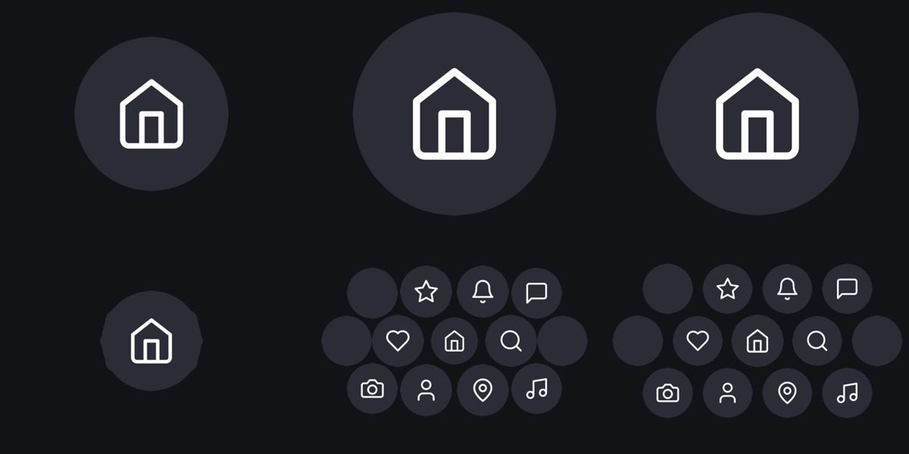

# OrbHero

A WebGL2 entrance animation for a hero banner: one large circle grows, then shrinks as a
lattice of circles springs out from behind it. Each circle is a picture (your icon art fills the
whole disc) or an empty disc. After landing they float gently and react to touch.

One file (`index.html`), no dependencies, no build step. `class OrbHero` is the engine; the page
around it is a demo.



*The entrance at 0.15s, 0.45s, 0.75s (top) and 0.95s, 1.15s, 1.4s (bottom). Placeholder art.*

Related: [`HANDOFF.md`](HANDOFF.md) covers building this into the PAM app (design-system rules,
what to change, open questions). This file is about the engine itself.

---

## 1. Run it

Open `index.html` in a browser. Buttons under the banner: **Replay**, **Exit**, **Tune**.

**Tune** opens sliders for the main values. Drag one and let go: the entrance replays with the
new value. **Copy config** gives you only what differs from the defaults, ready to paste into the
constructor. This is the fastest way to find the feel you want, especially on a real phone.

URL parameters on the demo page:

| Parameter | Effect |
|---|---|
| `?t=1.2` | Freeze at 1.2 seconds. Add `&x=0.5` to freeze 0.5s into the exit. |
| `?config={"spring":{"size":{"zeta":0.5}}}` | Apply a config. Handy for sharing a tuned setup as a link. |

## 2. Use it

```html
<canvas id="hero" aria-hidden="true" style="display:block; width:100%; aspect-ratio:4/3"></canvas>
<script>
  const hero = new OrbHero(document.getElementById('hero'), {
    icons: ['/img/a.png', '/img/b.png', '/img/c.png'],   // slot 0 = the centre circle
    onSettled: () => console.log('entrance done'),
  });
</script>
```

- **Size the canvas with CSS only.** Never set its `width`/`height` attributes; the engine reads
  the laid-out size (via `ResizeObserver`) and sets the pixel buffer itself.
- The canvas is transparent: whatever is behind it shows through.
- It is decorative. Mark it `aria-hidden="true"` and put real buttons over it if circles must be
  tappable.
- `new OrbHero` throws if WebGL2 is unavailable (catch it and show a static fallback).

### Lifecycle

| Call | Does |
|---|---|
| `new OrbHero(canvas, config)` | Builds GL state, uploads icons, then plays the entrance when `hero.ready` resolves. |
| `hero.play()` | Runs the entrance from the start. |
| `hero.exit()` | Runs the exit (outer circles shrink first, hero last). |
| `hero.configure(patch)` | Merges a partial config, rebuilds what depends on it, replays. Returns a Promise. **Throws** (and changes nothing) if the layout is invalid. |
| `hero.seek(t, exitT?)` | Freezes at an instant. For debugging and screenshots. |
| `hero.destroy()` | Stops the loop, removes listeners, frees GL objects. The canvas stays usable, so a new `OrbHero` can take over (React strict mode mounts twice). |
| `hero.ready` | Promise: icons uploaded, loop running. |
| `hero.config` | The live merged config. Treat as read-only; change it with `configure()`. |

React sketch (not run in this repo; `OrbHero` is currently a plain global, so export it first):

```jsx
function OrbHeroBanner({ config }) {
  const ref = useRef(null);
  useEffect(() => { const h = new OrbHero(ref.current, config); return () => h.destroy(); }, []);
  return <canvas ref={ref} aria-hidden="true" />;   // size it with your styling system
}
```

---

## 3. How it works

Read this before changing behaviour. Four steps, each a small function in `index.html`.

```
config ──► _layout() ──► per-circle records ──► _frame(now) ──► Float32Array ──► one draw call
            (on resize)    home position,         pure function    x, y, radius,     (instanced quads,
                           distance d, slot,       of time t         slot per circle   texture array)
                           float phases
```

1. **Layout** (`_layout`). `layout.rows` becomes one record per circle: a home position relative
   to the hero, its distance `d` from the hero, an icon slot, and seeded random float phases. It
   re-runs on resize. The hero is not in the list; it is the centre circle of the middle row.
2. **Time** (`_frame`, `_table`). Every frame is a pure function of `t`, seconds since `play()`.
   The springs are not simulated live: each is precomputed once into a 480Hz lookup table
   (`_buildTables`), so any instant can be drawn directly, and `seek(t)` is exact. The only live
   state is the touch response.
3. **Frame** (`_frame`). For each circle: how far along its spring is it (`tau = t - start`),
   where is it, how big, plus float offset and touch offset. These go into one `Float32Array`
   (8 floats per circle) which is uploaded to a GPU buffer.
4. **Draw.** A single `drawArraysInstanced`: one quad per circle. The fragment shader finds the
   pixel's position inside its circle, samples that circle's layer of a **texture array**, and
   multiplies by an antialiased circular mask. Nothing else is drawn: no fill, border or shadow.

### Units

- **Sizes and distances are canvas widths.** `0.1` is 10% of the canvas width. The layout scales
  with the canvas, and the canvas's aspect ratio only decides how much vertical room there is.
- **Times are seconds.**
- Pixels appear only in the shader and the frame buffer, never in config.

### Default timeline

```
t (s)   0        0.65             ~1.0          1.436
        │ hero grows │ hero springs back to rest
        │            │ circles start moving, nearest first (stagger 0.22s per unit of distance)
        │            │        circles overshoot, settle ─────►│ settled (onSettled)
        │                                                     │ float is fading in, touch enabled
```

| Moment | Default | Set by |
|---|---|---|
| Hero reaches full size | 0.65s | `timing.heroGrow` |
| Other circles start | same instant (nearest at 0.69s, farthest at 0.74s) | `timing.latticeStart` (null = `heroGrow`), `timing.stagger` |
| Last circle has landed (`onSettled`, touch enabled) | 1.436s | `timing.landing`, derived |
| Float finishes fading in | landing + 1.2s | `idle.fade` |
| Exit finishes | 0.95s after `exit()` | `exit.stagger + exit.dur` |

### Springs, in one paragraph

A circle's position and size each follow a damped spring toward 1. `zeta` is damping: 1 means no
overshoot, lower overshoots more (`0.8` gives 1.5%, `0.62` gives 8%, `0.5` gives 16%). `omega` is
stiffness in rad/s: higher is faster, and a spring settles in about `4 / (zeta * omega)` seconds.
The target is eased in over `spring.ramp` seconds rather than jumping, so a spring leaves rest
smoothly. Set `ramp: 0` and every circle gets a visible kick at the start.

### Icons

Each icon is one **layer** of a texture array (`iconRes` pixels square, with its own mipmaps),
plus one extra layer holding the empty disc. Slot 0 goes to the hero. The other circles take
slots 1, 2, 3… in order of distance from the hero, repeating if there are more circles than icons.
Empty circles always use the extra layer. Image icons are **cover-fit and centred** into the layer,
and the shader clips them to the circle, so a square photo or art with transparent corners both
work.

---

## 4. Configuration reference

Pass any subset; it is merged over `OrbHero.DEFAULTS` (plain objects merge, arrays and values
replace). **`OrbHero.DEFAULTS` in `index.html` is the source of truth**, with the same comments;
this table is a map to it.

```js
new OrbHero(canvas, { size: { circle: 0.08 }, spring: { size: { zeta: 0.5 } } })
```

### Content

| Key | Default | What it does |
|---|---|---|
| `icons` | `null` | Array of icons. `null` uses the built-in placeholders. Each entry is a URL or data URI, an ``/`<canvas>`/`ImageBitmap`, or `{ path: 'SVG path d' }` (24×24, drawn white on a disc: placeholder art only). Image icons **fill the whole circle**. |
| `colors.placeholder` | `['#2a2d36']` | Disc colour behind `{ path }` icons, cycled by slot. Does not affect image icons. |
| `colors.empty` | `'#2a2d36'` | Colour of a circle left empty. |

### Layout

| Key | Default | What it does |
|---|---|---|
| `layout.rows` | `[4, 5, 4]` | Circles per row, top to bottom. Rows are centred, which makes a hex lattice. **Must have an odd number of rows and an odd middle row**: the hero is the middle circle of the middle row. |
| `layout.empty` | `[[0,0],[1,0],[1,4]]` | `[row, column]` (zero-based) of circles with no icon. Naming the hero's cell does nothing. |
| `layout.pitch` | `0.195` | Distance between neighbours in a row. |
| `layout.rowSpacing` | `0.87` | Row gap as a share of `pitch`. `0.87` is a true hex lattice; `1` is a square grid. |
| `layout.center` | `[0.5, 0.5]` | Where the hero sits, as a fraction of the canvas `[x, y]`. |

### Size

| Key | Default | What it does |
|---|---|---|
| `size.start` | `0.15` | Hero radius at t = 0. |
| `size.heroPeak` | `0.34` | Hero radius when fully grown. Keep ≤ half the canvas height (`aspect / 2`, 0.375 at 4:3). |
| `size.circle` | `0.08` | Radius of every other circle at rest. |
| `size.heroRestScale` | `1.12` | The hero rests at `circle × this`. |

### Timing (seconds)

| Key | Default | What it does |
|---|---|---|
| `timing.heroGrow` | `0.65` | Length of the hero's growth. The spring-back starts after it. |
| `timing.latticeStart` | `null` | When other circles start moving. `null` = `heroGrow`. Lower overlaps the two phases. |
| `timing.stagger` | `0.22` | Extra delay per unit of distance from the hero. `0` = all at once. |
| `timing.landing` | `0.7` | A circle counts as landed this long after it starts. Float fades in from then, and `onSettled` is derived from it. |
| `timing.heroLanding` | `0.9` | Same for the hero, counted from the end of `heroGrow`. |

### Springs

| Key | Default | What it does |
|---|---|---|
| `spring.ramp` | `0.2` | Seconds to ease each spring's target in. `0` = a hard kick. |
| `spring.position` | `{ zeta: 0.80, omega: 10 }` | Where circles travel. Barely overshoots. |
| `spring.size` | `{ zeta: 0.62, omega: 10 }` | How big they get: the soft pop. |
| `spring.hero` | `{ zeta: 0.66, omega: 9.5 }` | The hero's shrink. Dips a little under its rest size. |

### Float, touch, exit, render

| Key | Default | What it does |
|---|---|---|
| `idle.driftX` / `driftY` | `0.0065` / `0.0075` | Float amplitude, canvas widths (about 3px on a 402px canvas). `0` for none. |
| `idle.breathe` | `0.012` | Size pulse, as a fraction. |
| `idle.fade` | `1.2` | Seconds for the float to fade in after landing. |
| `idle.freq` | `{ x: [.11,.19], y: [.13,.23], breathe: [.12,.20] }` | Hz range each circle picks from. |
| `idle.seed` | `7` | Changes every circle's phases. Same seed = same motion. |
| `idle.heroFreq` / `heroPhase` | `[.15,.18,.14]` / `[1.3,4.1,2.2]` | The hero's own float. |
| `touch.enabled` | `true` | Turn the touch/hover response off. |
| `touch.enableAfter` | `null` | Seconds from `play()` before it reacts. `null` = once the last circle has landed. |
| `touch.radius` | `0.22` | Reach of the push, canvas widths. |
| `touch.stiffness` / `damping` | `36` / `3.6` | The spring pulling a circle home, and its friction. Lower damping wobbles longer. |
| `touch.hover` / `press` / `tap` | `1.8` / `3.2` / `0.3` | Push strength hovering, pressed, and the extra kick at the moment of press. |
| `touch.heroMass` | `0.6` | Below 1, the hero reacts less than the others. |
| `exit.dur` / `exit.stagger` | `0.6` / `0.35` | How long each circle takes to shrink away, and the spread of start times. |
| `render.iconRes` | `512` | Pixels per icon layer. Memory is about `iconRes² × 5.3` bytes per icon. |
| `render.maxDpr` | `2` | Cap on `devicePixelRatio`, to bound fill cost on 3× phones. |
| `onSettled` / `onExited` | `null` | Called once per `play()` / `exit()`. Not called while `seek()` has it frozen. |

---

## 5. Recipes

**Use my icons.** Square art, because it fills the circle. Slot 0 is the centre.
```js
{ icons: ['hero.png', 'a.png', 'b.png', 'c.png'] }
```
Fewer icons than circles repeat in order. An icon with its own background needs no disc.

**Change the grid.** Rows are counts; the middle row sets the hero.
```js
{ layout: { rows: [3, 3, 3], empty: [], pitch: 0.24 } }
{ layout: { rows: [4, 5, 4], empty: [[0,0],[0,3],[2,0],[2,3],[1,0],[1,4]] } }   // empties on the corners and ends
```
**Making it fit.** The widest row must fit the width: `(widest − 1) / 2 × pitch + size.circle ≤ 0.5`.
The rows must fit the height: `(rows − 1) / 2 × pitch × rowSpacing + size.circle ≤ aspect / 2`, where
`aspect` is canvas height ÷ width (0.75 at 4:3). Neighbours touch when `2 × size.circle` reaches
`pitch`. The hero also needs `size.heroPeak ≤ aspect / 2` or its peak is clipped.

**A different aspect ratio.** Change the canvas's CSS `aspect-ratio`. The layout is in canvas
widths, so only the vertical fit above changes. A 16:9 banner (`aspect = 0.5625`) needs a smaller
`heroPeak`, about `0.27`.

**Make it bouncier / calmer / faster.**

| Want | Change |
|---|---|
| More bounce on size | lower `spring.size.zeta` (0.62 → 0.5) |
| Dead calm, no overshoot | all three `zeta` to `1` |
| Faster overall | raise every `omega` and lower `timing.stagger`, together (×1.5 omega ≈ ×1.5 faster) |
| Slower, heavier | lower `omega` (10 → 6) and raise `timing.heroGrow` |
| Circles arrive together | `timing.stagger: 0` |
| Circles start while the hero is still growing | `timing.latticeStart: 0.4` |

**No float / no touch.**
```js
{ idle: { driftX: 0, driftY: 0, breathe: 0 }, touch: { enabled: false } }
```

**Move the hero.** `layout.center: [0.5, 0.45]` shifts the whole lattice up a little.

**Know when it's done.**
```js
{ onSettled: () => enableButtons(), onExited: () => hideBanner() }
```

**Change things at runtime.**
```js
await hero.configure({ colors: { empty: '#444' } });   // rebuilds icons, then replays
hero.configure({ spring: { size: { zeta: 0.5 } } });   // cheap: only tables and layout
```

**Reduced motion.** Handled: with `prefers-reduced-motion`, it jumps straight to the finished
layout with no float or touch response, and calls `onSettled` on the first frame.

---

## 6. Rendering notes (why it is built this way)

These came from bugs; please don't undo them without reading.

- **Texture array, not an atlas.** Icons once shared one atlas texture. Bilinear and mipmap
  sampling then bled a neighbouring icon's edge into each icon, which shimmered as circles moved
  (a faint flickering border). One layer per icon cannot do that.
- **No shadow, border or fill.** The icon *is* the circle. A baked drop-shadow added a dark halo.
- **Edge coverage is solid out to the radius and only feathers outside it** (`smoothstep(1, 1+aa, r)`).
  Feathering inward thinned the artwork's own antialiased edge, which read as a faint ring.
- **Premultiplied alpha throughout** (`UNPACK_PREMULTIPLY_ALPHA_WEBGL`, `blendFunc(ONE, ONE_MINUS_SRC_ALPHA)`,
  `premultipliedAlpha: true`). Mixing straight and premultiplied alpha gives dark fringes.
- **Never switch a motion on at full strength.** The idle float used to start abruptly at 2.4s and
  every circle stepped a few pixels at once. It now fades in per circle after landing.
- **Never start a spring with a kick.** That is what `spring.ramp` prevents.
- **No device-tilt parallax.** It moved the icon inside its box and exposed edges. Not in the
  reference recording; leave it out.
- **Draw order:** circles nearest-first, then the hero last, so the hero sits above the others
  during the hand-off.

## 7. Checking your changes

Scripts in [`tools/`](tools/). They need Playwright and a Chromium; point at them with
`PLAYWRIGHT_PATH` and `CHROMIUM_PATH` if they are not on the default path. Chromium runs on a
software GL stack, so these prove **correctness, not speed**.

| Script | Answers |
|---|---|
| `node tools/check-motion.cjs [--config '{...}']` | Is the motion smooth? Spring overshoot, frame-to-frame jumps, idle smoothness, a synthetic touch trace. A real jump is a spike far above its neighbours (the entrance's long outer travel reads about 3; idle reads about 0.02). |
| `node tools/regress.cjs --save f.json` then `--compare f.json` | Did my change alter the animation? Compares every circle's position and size at 66 instants. A refactor that should not change anything must report a difference of exactly `0`. Exit code 1 if not. |
| `node tools/snapshot.cjs out/ --times 0.2,0.8,3 [--config '{...}'] [--exit 0.5]` | Writes PNGs of the banner at those instants. |

Throwaway checks can call `hero.seek(t)` then `hero._frame(t * 1000)` and read `hero.data` (8 floats
per circle: x, y, radius, unused, slot, 0, 0, opacity, in device pixels).

## 8. Known limits

- **Not tested on a real phone.** Everything here was run in headless Chromium on a software
  renderer. Frame rate, battery and touch feel are unknown. `touch.hover/press/tap` are guesses to tune.
- **WebGL2 only.** There is no WebGL1 or 2D fallback; show a static layout if the constructor throws.
- **It does not pause off-screen.** `requestAnimationFrame` already pauses in background tabs, but
  a banner scrolled out of view keeps drawing. Add an `IntersectionObserver` if it matters.
- **No context-loss recovery.** If the browser drops the GL context, the banner stops drawing.
- **Cross-origin icons** must send CORS headers, or the canvas upload fails.
- **Single file, plain global.** Move `class OrbHero` into a module to import it.
